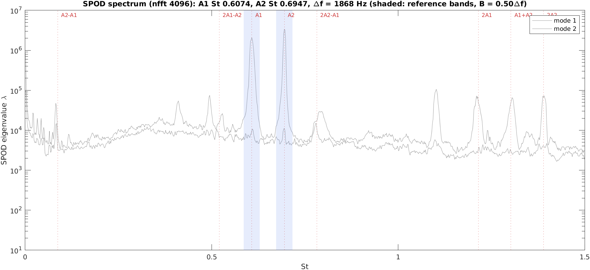
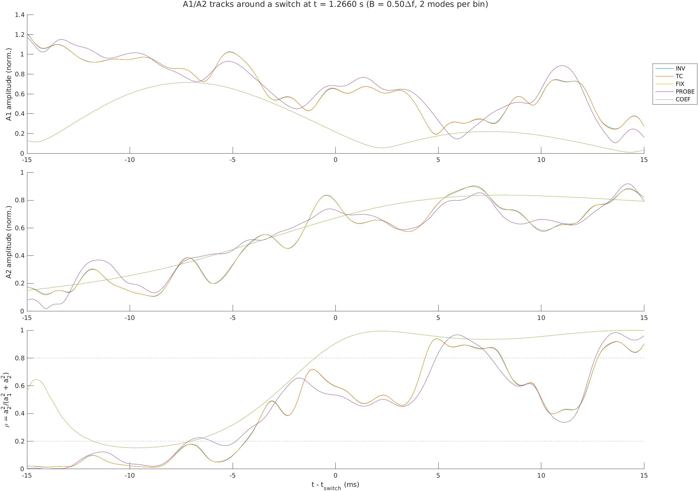
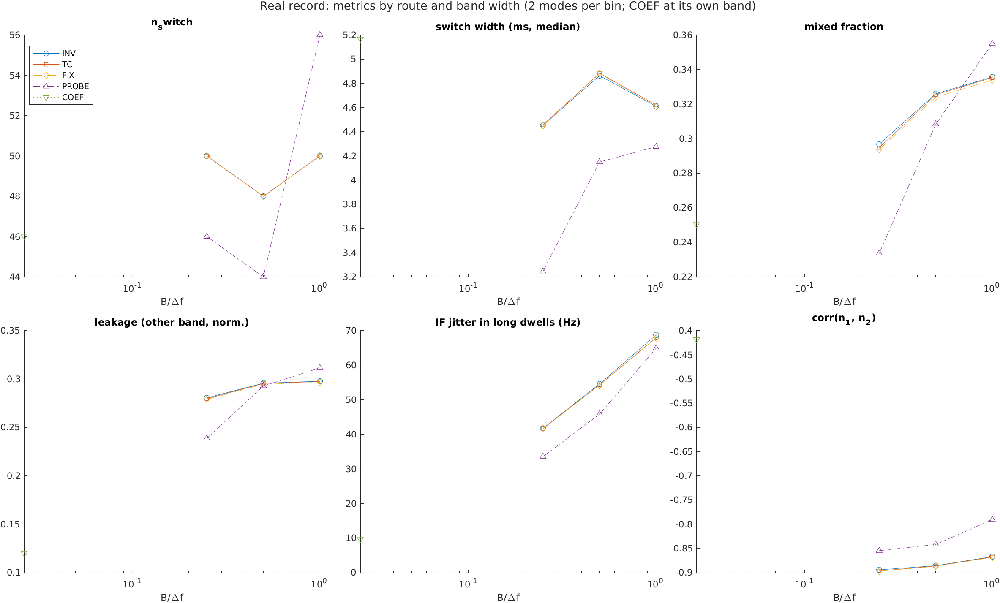
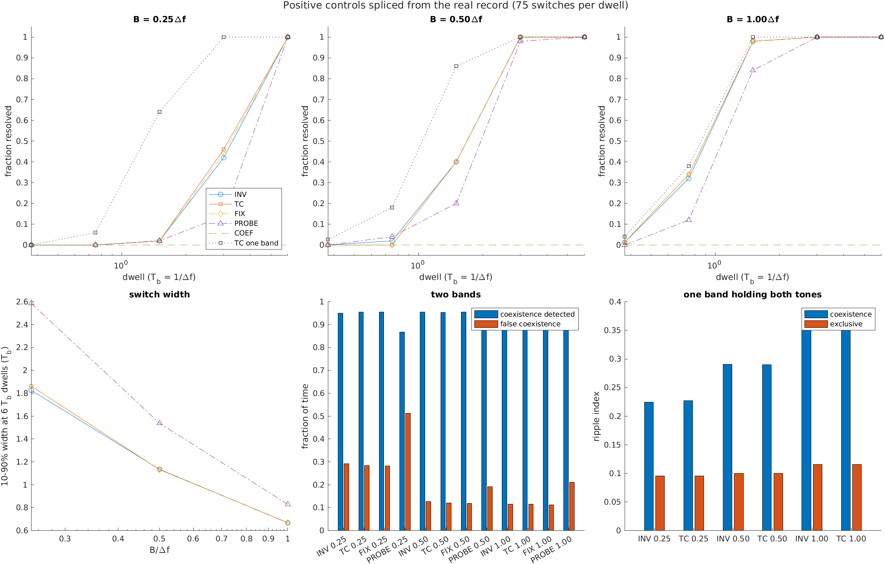
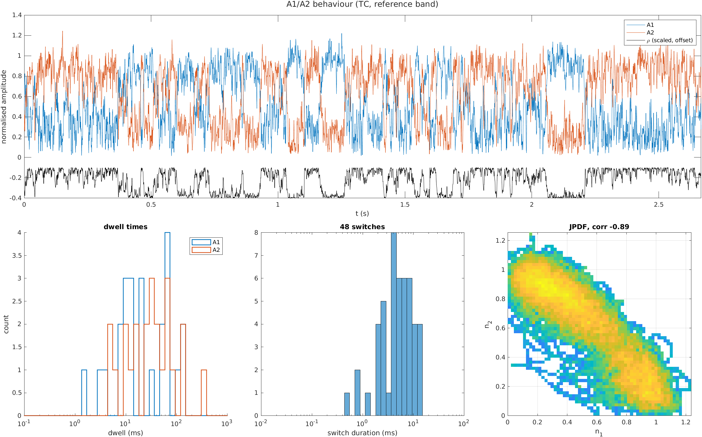
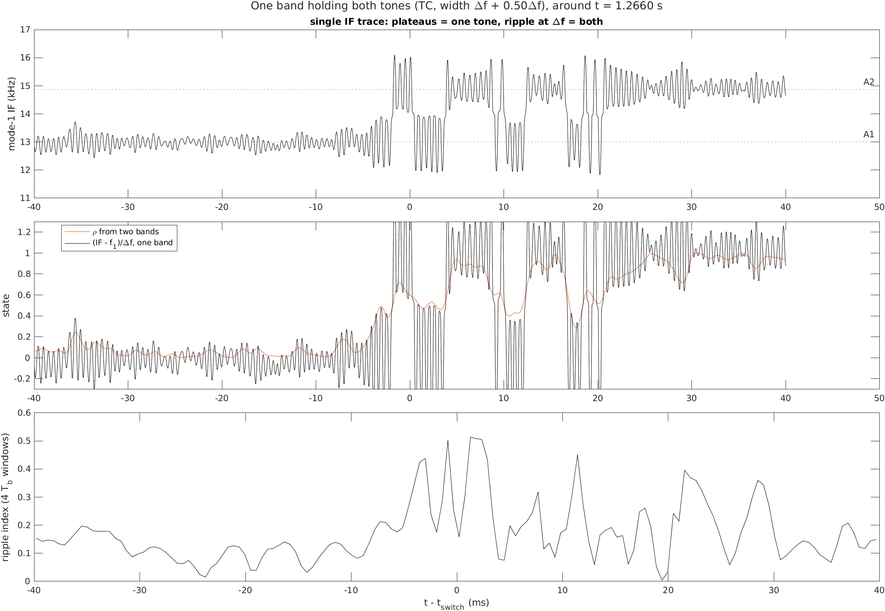
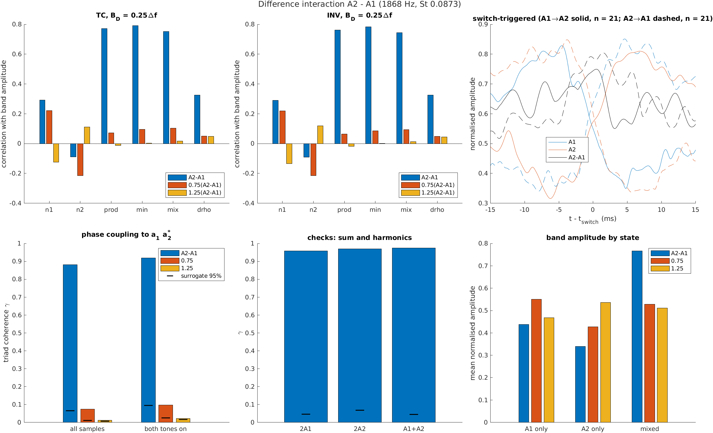
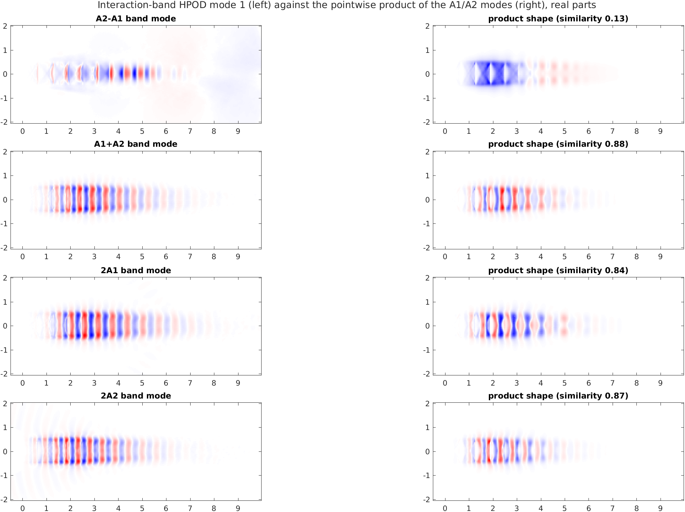
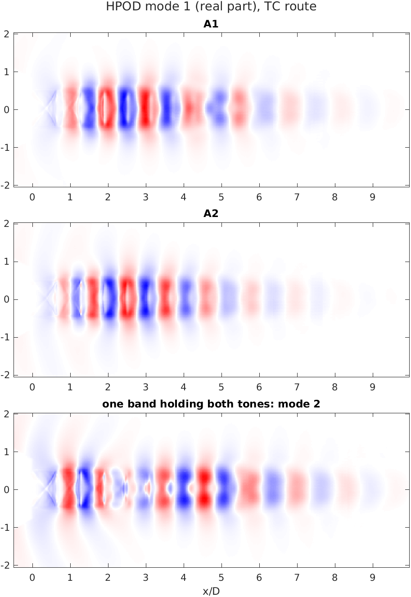
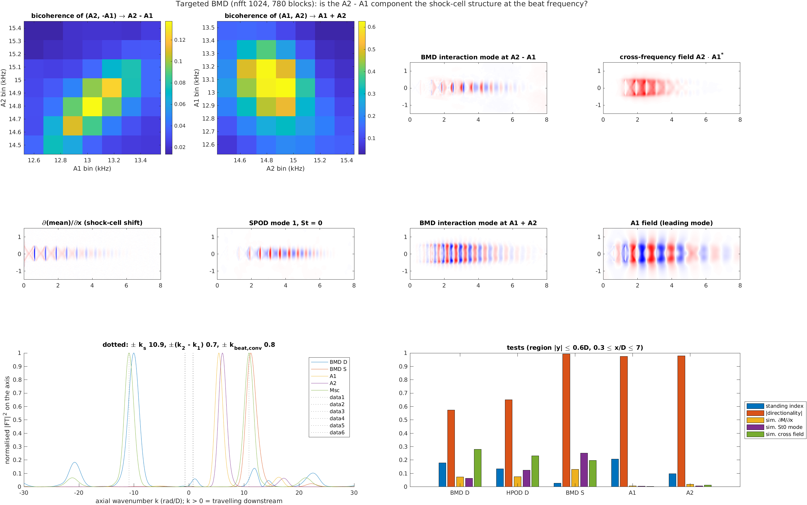

# Isolating and comparing A1 and A2: method tests on the 400k-frame schlieren record

**Data:** `Schlieren/Large_Test/Data/Axisymmetric_16mm_Medium_Lip_NPR_2199_Fields.mat` on M3. Axisymmetric jet, D = 16 mm, medium lip, NPR 2.199; 400,000 frames at 150 kHz (2.67 s); 200 × 512 pixels covering x/D −0.5 to 10.

**SPOD:** the existing `Large_Test/SPOD_Results` file (n_fft 4096, 50% overlap, 4 modes, patched `spod.m`). The testing fork confirmed it is final.

**Where things are:** code and results in `/fs04/scratch2/ty79/JWeightman/Schlieren/HPOD_Investigation` (`Code/`, `Data/`, `Figures/`, `Logs/`); a copy of the code and this write-up in the repository at `Codebase/HPOD_Investigation/`. All numbers are from run 2026-10-23 (jobs 61385838, 61386484, 61387366; BMD jobs 61394945 and 61390555).

## Summary

**How to isolate the tones**
- **The isolation route makes no measurable difference on this data.** These three agree to within 1% in every metric, on the real record and on controls with ground truth:
  - the group's pipeline: invspod → Hilbert → HPOD;
  - the tcoeffs band field → POD (`hpod_from_spod_tcoeffs`, no Hilbert step);
  - projecting the band onto one fixed SPOD mode.

  invspod's block-joining IF error is far below the tones' real frequency wander (30–80 Hz). So results from the previous invspod + HPOD analyses stand. The tcoeffs route is still preferable: no Hilbert step, no block joins, and cheaper.
- **The band width B is the setting that matters**, and it trades switch-time resolution against IF noise. Controls spliced from the real record give, in fraction of switches resolved:

  | B | ≥ 1.5 T_b dwells | ≥ 3 T_b | 6 T_b |
  |---|---|---|---|
  | Δf | 98% | — | — |
  | 0.5Δf | 40% | 100% | — |
  | 0.25Δf | — | 46% | 100% |

  Here Δf = A2 − A1 = 1868 Hz and T_b = 1/Δf = 0.54 ms. At 0.25Δf, false coexistence also rises from 0.12 to 0.28. Real switches take a median of 4.9 ms (about 9 T_b), so **B = 0.5Δf** (≈ 0.044 in St, close to the 0.05 used before) resolves them. Use **B = Δf** if sub-3 T_b events matter.
- **SPOD modes per bin (1, 2 or 4) make no difference.**
- **A single pixel and the direct tcoeffs coefficient are worse.**
  - *Single lipline pixel:* slower, with 1.5–2× the false coexistence.
  - *Direct coefficient:* its 27 ms window (n_fft 4096) cannot follow these switches at all; none resolved in the controls.
- **One band holding both tones is a useful extra diagnostic.** Its mode-1 IF gives plateaus for one tone and a ripple at Δf for both. It resolves faster switches than two separate bands of the same B, and it shows the coexistence directly (Fig. 9).

**What the tones do**
- **Strongly anti-correlated** (−0.89), with A2 dominant 64% of the time. There are 48 switches in 2.6 s. Median dwells are 19 ms (A1) and 30 ms (A2), with the longest 150 ms and 330 ms.
- **Switches are slow and physical.** The median is 4.9 ms (IQR 2.5–7.6 ms), against an instrument width of about 0.6 ms.
- **Not strictly exclusive.** During long single-tone dwells, the weaker tone persists at about 0.29 of its peak amplitude (about −9 dB below the dominant tone), against a noise floor of 0.06. It is phase-coherent (0.64, against 0.46 for noise), and the single-band IF ripples at Δf throughout.
- **The short-time mean (St ≈ 0, SPOD mode 1) tracks which tone dominates:** correlation −0.92 with ρ. This reproduces Mazharmanesh et al. (2026).

**The A2 − A1 difference interaction** (1868 Hz, St 0.087)
- **It is a genuine quadratic interaction between A1 and A2.** Its band is phase-locked to a₁a₂\* (triad coherence 0.88, against a 95% surrogate level of 0.065). Bands at 0.75 and 1.25 × (A2 − A1) show almost no locking (0.07 and 0.01).
- **Its amplitude follows the product of the two tones, not either tone alone.** Correlation is 0.77 with n₁n₂, 0.79 with min(n₁, n₂) and 0.75 with ρ(1 − ρ), against 0.29 and −0.09 with n₁ and n₂. It peaks in mixed states (0.77, against 0.34–0.44).
- **Its spatial mode is not the pointwise product of the A1 and A2 modes** (similarity 0.13, against 0.84–0.88 for the sum and the harmonics). It sits along the axis in the shock-cell region (x/D ≈ 1–6). So it is unlikely to be an optical or camera intermodulation product.
- **BMD shows it is the beat scattered by the shock cells, not the cells oscillating at the beat** (Section 6). It is not standing (index 0.18), and it does not resemble a shift or breathing of the cells (similarity ≤ 0.20).
  - Its axial wavenumber spectrum is a comb at (k₂ − k₁) + n·k_s, dominated by the upstream-phase n = −1 term, k₂ − k₁ − k_s.
  - The BMD mode matches the HPOD mode (0.98).
  - The sum A1 + A2, by contrast, is a plain downstream product wave (similarity 0.88 to the product).
- **For the difference band, correlate with n₁n₂ (not with n₁ or n₂ separately), check phase coupling, and keep the band narrow (≤ 0.25Δf)** so that the control bands don't overlap it.

## 1. The tones and the approach

**Fig. 1.** Mode-1 and mode-2 SPOD spectra, with the tones and their interaction frequencies marked.
- **The tones:** A1 = 13.00 kHz (St 0.6074) and A2 = 14.87 kHz (St 0.6947), from the mode-1 peaks. Their mean instantaneous frequencies are 13.010 and 14.877 kHz. These match Mazharmanesh et al. (2026) at NPR 2.20 (St 0.606 and 0.694).
- **Interaction lines:** A2 − A1, A1 + A2, 2A1, 2A2, 2A1 − A2 and 2A2 − A1 all show in the spectrum.
- **Shading:** the reference bands (B = 0.5Δf).

**One pass over the data, everything else in projection space.** Every route tested is linear in the data:
- tcoeffs;
- invspod followed by a Hilbert transform in time;
- POD of a band field;
- projection onto a mode;
- splicing segments together.

So the record was read once (stage 1, 6 min, 12 GB peak) and projected onto the saved SPOD modes, p_k(t) = P_kᴴ(x(t) − x̄). This covers every bin in four bands (444 bins × 4 modes):
- St 0–0.03, the short-time mean;
- St 0.03–0.16, the difference band;
- St 0.50–0.80, the tones;
- St 1.15–1.45, the harmonics and the sum.

Each route then works on these 1776 series (5.8 GB). The PODs are computed exactly through the modes' Gram matrices Pᴴ P and Pᵀ P, without rebuilding the 400k × 102k field.

**Checks that projection space gives the group's results:**
- *Block coefficients:* rebuilt from the projections, they match the SPOD file's A to 1.4 × 10⁻⁷ (mode 1).
- *Synthetic record* (`Code/tests/test_projection_routes.m`):
  - the projection-space invspod + Hilbert + POD matches the patched `invspod` → `hilbert` → POD to 2 × 10⁻⁷;
  - the tcoeffs route matches `hpod_from_spod_tcoeffs` to 2 × 10⁻⁸;
  - tcoeffs itself matches to 3 × 10⁻⁸.

**Routes compared (mode 1 of each band):**

| Route | What it is |
|---|---|
| INV | invspod of the band (`Codebase_Patches`, with dt) → analytic signal in time → POD: the previous approach |
| TC | tcoeffs band field Σ P a (already analytic) → POD: `hpod_from_spod_tcoeffs` |
| FIX | TC band field projected onto the peak bin's mode-1 SPOD mode |
| COEF | the single tcoeffs coefficient at the peak bin, mode 1 (no reconstruction) |
| PROBE | one lipline pixel, Gaussian band-pass of the same RMS width, analytic signal. The pixel is x/D = 2.0, y/D = 0.49, where both tones are strongest of 14 lipline probes |

**Settings and definitions:**
- *Band widths:* B = 0.25, 0.5 and 1 × Δf around each tone.
- *Modes per bin:* 1, 2 or 4.
- *Instantaneous frequency:* least-squares phase slope over max(1/B, 2 periods).
- *Normalised amplitudes:* n₁, n₂ are the amplitudes scaled by their 95th percentiles.
- *State indicator:* ρ = n₂²/(n₁² + n₂²), with hysteresis. The state is A1 when ρ < 0.2, A2 when ρ > 0.8, and "mixed" in between.

## 2. Isolation on the real record

**Fig. 2.** A1 and A2 amplitudes and ρ for each route around one transition (B = 0.5Δf).
- **INV, TC and FIX lie on top of each other.**
- **PROBE** is similar but noisier.
- **COEF** is smeared over its 27 ms window.

This transition is not a clean switch: ρ sits near 0.5 for about 10 ms before A2 takes over. That is the kind of mixing that Section 4 quantifies.

**Fig. 3.** Real-record metrics against B. The "leakage" panel shows the other band's normalised amplitude inside the reference method's long dwells.

| Route, B | Switches | Median switch (ms) | Mixed fraction | corr(n₁, n₂) | Weak tone in long dwells | IF jitter A1/A2 (Hz) |
|---|---|---|---|---|---|---|
| INV / TC / FIX, 0.25Δf | 50 | 4.45 | 0.295 | −0.90 | 0.25 / 0.31 | 54 / 30 |
| INV / TC / FIX, 0.5Δf | 48 | 4.88 | 0.325 | −0.89 | 0.26 / 0.33 | 69 / 40 |
| INV / TC / FIX, Δf | 50 | 4.61 | 0.335 | −0.87 | 0.27 / 0.33 | 81 / 55 |
| PROBE, 0.5Δf | 44 | 4.15 | 0.308 | −0.84 | 0.28 / 0.31 | 57 / 34 |
| COEF | 46 | 5.17 | 0.250 | −0.42 | 0.11 / 0.13 | 9 / 10 |

INV, TC and FIX agree to the digits shown, at every B, and with 1, 2 or 4 modes per bin. Each tone band is about 98% one POD mode (mode-1 energy 0.96–0.99), so the choice of reconstruction or projection does not matter. COEF's low jitter and low "leakage" come from its 27 ms smoothing, not from better isolation. The noise band midway between the tones sits at 0.05 of the A1 level.

## 3. Positive controls with ground truth

A1-only and A2-only stretches of the real record were cut from the projections and joined into a known schedule:
- **The stretches:** where ρ < 0.1 or ρ > 0.9 throughout, giving pools of 495 ms and 689 ms.
- **The joins:** two-period raised-cosine cross-fades.
- **The dwells:** 0.375–6 T_b, plus 6 T_b coexistence intervals where an A2 stretch scaled to 0.61 of A1's level is added. Each schedule is repeated 25 times, giving 75 switches per dwell.

This has the real turbulence, camera noise and mode shapes, but known switch times. Every route and B was scored on it (stage 3), with the scoring of `Codebase/HPOD_Switch_Benchmark`.

**Fig. 4.** Positive controls.
- **Top row:** fraction of switches resolved against dwell, for each B. The dotted line is one band holding both tones.
- **Bottom left:** the 10–90% switch width at 6 T_b dwells.
- **Bottom centre:** coexistence detected (two bands), and false coexistence in exclusive segments.
- **Bottom right:** the single-band ripple index in coexistence and exclusive segments.

**Fraction of switches resolved:**

| Route, B | 0.375 T_b | 0.75 T_b | 1.5 T_b | 3 T_b | 6 T_b | 10–90% width (T_b) | Coexistence found | False coexistence |
|---|---|---|---|---|---|---|---|---|
| TC (= INV = FIX), 0.25Δf | 0 | 0 | 0.02 | 0.46 | 1 | 1.9 | 0.96 | 0.28 |
| TC, 0.5Δf | 0 | 0 | 0.40 | 1 | 1 | 1.1 | 0.95 | 0.12 |
| TC, Δf | 0.01 | 0.34 | 0.98 | 1 | 1 | 0.67 | 0.95 | 0.11 |
| PROBE, 0.5Δf | 0 | 0.04 | 0.20 | 0.98 | 1 | 1.5 | 0.96 | 0.19 |
| PROBE, Δf | 0 | 0.12 | 0.84 | 1 | 1 | 0.83 | 0.97 | 0.21 |
| COEF | 0 | 0 | 0 | 0 | 0 | — | 0.83 | 0.83 |
| one band, Δf + 0.5Δf | 0.03 | 0.18 | 0.86 | 1 | 1 | 0.47 | — | — |
| one band, Δf + Δf | 0.04 | 0.38 | 1 | 1 | 1 | 0.40 | — | — |

The ripple index of the single band is 0.29 in coexistence against 0.10 in exclusive segments (Δf + 0.5Δf). The exclusive baseline is not zero: the pools themselves carry the weak other tone (Section 4), and so does part of the "false coexistence" of the two-band methods.

**What the controls show:**
- **Switch resolution follows B,** as in the synthetic benchmark (switch width ≈ 0.6–1/B). Separate bands need B ≳ Δf to follow switches faster than about 1.5 T_b.
- **One band holding both tones is faster.** It does not need the tones kept apart, but its 50% crossing is biased by about 0.2 T_b.
- **The single pixel is consistently worse than any field method** at the same B. It is noisier and loses the POD's spatial averaging.
- **The direct coefficient cannot be used for switch dynamics** with n_fft 4096.

## 4. A1/A2 behaviour

**Fig. 5.** TC, B = 0.5Δf.
- **Top:** normalised A1 and A2 amplitudes over the whole record, and ρ.
- **Bottom:** dwell-time histograms, switch durations, and the joint PDF of (n₁, n₂).

**Switching statistics:**
- **Time in each state:** A2 dominates 64% of the time and A1 36%. Both tones are never off together (off fraction 0).
- **Dwells:** A1 24 dwells, median 18.5 ms (IQR 9.2–66 ms, longest 147 ms); A2 23 dwells, median 29.8 ms (IQR 13–70 ms, longest 326 ms).
- **Switches:** 48. Each takes a median of 4.9 ms (IQR 2.5–7.6 ms), about 9 T_b or 64 A1 cycles. That is about eight times the instrument width at this B (Fig. 4), so these are physical transition times. Only a few switches (about 4 of 48, under 1.2 ms) come near the resolution.

**Weak coexistence.** The JPDF has two lobes joined along the anti-diagonal (correlation −0.89; Mazharmanesh et al. found −0.82). Neither lobe sits on an axis: the weaker tone does not vanish. Inside 473 five-millisecond windows within long dwells:

| | Amplitude (fraction of its 95th pct) | Phase coherence over 5 ms | IF spread (Hz) |
|---|---|---|---|
| Dominant tone | 0.85 | 0.94 | 30 |
| **Weaker tone** | **0.29** | **0.64** | **94** |
| Noise band midway | 0.06 | 0.46 | 257 |

The weaker tone is about five times the noise level. It holds its frequency far better than band noise, but less steadily than the dominant tone, so it is intermittent or fluctuating. Spectral leakage cannot explain it: the tones are 51 bins apart.

**Fig. 9.** One band holding both tones, around the Fig. 2 transition.
- **During A1 dominance:** the single IF ripples gently at Δf around f₁ (top), as Mandel's two-tone formula predicts for a second tone at about 0.2–0.3 of the amplitude.
- **Through the transition:** it swings between large excursions.
- **After the transition:** it ripples around f₂.
- **Middle:** the IF state agrees with the two-band ρ.
- **Bottom:** the windowed ripple index rises through the mixed stretch.

**How this relates to the published exclusivity.** Mazharmanesh et al. (2026) found the tones mutually exclusive in this condition (JPDF corner peaks; "both on" never occurred), using n_fft 1024 SPOD windows (6.8 ms). The results here agree that the two never sit strongly on together. They add that the subdominant tone is still present at about 0.34 of the dominant tone's amplitude (−9 dB). It is also not obvious that a 6.8 ms windowed SPOD coefficient would separate that level from the turbulence. Whether this record is the same acquisition as the paper's is not established here.

**Short-time mean.** The St ≈ 0 tcoeffs coefficient of SPOD mode 1 correlates with ρ at −0.92 (+0.92 with n₁, −0.92 with n₂). Mode 2 gives 0.28. This reproduces Mazharmanesh et al.'s finding that each tone sits on its own short-time mean, now as a continuous trace.

## 5. The difference interaction A2 − A1

**Fig. 6.** Difference band (1868 Hz, width B_D = 0.25Δf), with control bands at 0.75 and 1.25 × (A2 − A1).
- **Top left and centre:** correlations of the band amplitudes with n₁, n₂, n₁n₂, min(n₁, n₂), ρ(1 − ρ) and |dρ/dt|, for TC and INV. All series are smoothed to 1/B_D (2.1 ms).
- **Top right:** switch-triggered averages (21 switches each way).
- **Bottom left:** triad coherence γ = |⟨a_D a₂\* a₁⟩| / √(⟨|a_D|²⟩⟨|a₁a₂|²⟩), with 95% levels from 200 circular-shift surrogates.
- **Bottom centre:** the same check for the sum and the harmonics.
- **Bottom right:** band amplitude by state.

| Test (TC, B_D = 0.25Δf; INV agrees within 0.01) | A2 − A1 band | 0.75 × | 1.25 × |
|---|---|---|---|
| corr with n₁ | 0.29 | 0.22 | −0.13 |
| corr with n₂ | −0.09 | −0.22 | 0.11 |
| corr with n₁n₂ | **0.77** | 0.07 | −0.01 |
| corr with ρ(1 − ρ) | **0.75** | 0.10 | 0.02 |
| corr with \|dρ/dt\| | 0.33 | 0.05 | 0.05 |
| mean amplitude: A1 only / A2 only / mixed | 0.44 / 0.34 / **0.77** | 0.55 / 0.43 / 0.53 | 0.47 / 0.54 / 0.51 |
| triad coherence γ (surrogate 95%) | **0.88** (0.065) | 0.074 (0.011) | 0.011 (0.007) |
| γ with both tones above 0.3 | **0.92** (0.094) | 0.096 (0.025) | 0.022 (0.016) |

**What this shows:**
- **It is a genuine quadratic interaction.** The A2 − A1 band is almost fully phase-locked to a₁a₂\*. Its amplitude follows the product of the two tones (or the weaker of them), not either tone alone.
- **It peaks when the tones mix.** The lagged correlation with n₁n₂ peaks at 0.77 at +0.5 ms, within the 2.1 ms resolution, so there is no measurable lead or lag.
- **It is present even in "single-tone" states** (0.34–0.44), because the weak tone persists there (Section 4).
- **The rise around switches is moderate,** because transitions are slow mixings rather than jumps.
- **As a check, the method finds the expected coupling elsewhere.** The sum A1 + A2 (γ = 0.975), 2A1 (0.958) and 2A2 (0.970) are all locked. The harmonics follow their own tone (2A1: 0.88 in A1 states, 0.14 in A2 states). The sum, like the difference, peaks in mixed states (0.82).
- **Keep the difference band narrow.** At B_D = 0.5Δf, the 0.75× control band reaches the A2 − A1 line and picks it up (γ = 0.77). B_D ≤ 0.25Δf keeps the controls clean.

**Fig. 8.** HPOD mode 1 of each interaction band (left) against the pointwise product of the A1 and A2 modes (right).

**Is it in the flow or in the optics?** A schlieren system or camera with a nonlinear response would also create phase-locked sum, difference and harmonic products. Those would carry the pointwise product of the tones' shapes, φ₁φ₂\*.
- **The sum and the harmonics do match their products** (similarity 0.84–0.88). For them, flow and optical nonlinearity cannot be told apart this way.
- **The A2 − A1 mode does not** (0.13). It is a short-wavelength structure along the axis through the shock cells (x/D ≈ 1–6). The product is a long-wavelength blob over x/D ≈ 1–3.

So the difference component is not a local intermodulation product. The working hypothesis was that it is the shock-cell structure responding to the A1/A2 beat: a cross-difference counterpart of the difference self-interaction (St_s − St_s = 0) that sets each tone's short-time mean in Mazharmanesh et al. (2026). Section 6 tests this with BMD and refines it: the shock cells shape the component, but it is not a standing response of the cells.

The baseline with the product shifted 0.5D downstream is not a useful null for the short-wavelength sum and harmonic products (0.70–0.76), because a 0.5D shift is close to a whole number of their wavelengths.

**Fig. 7.** HPOD mode 1 of the A1 and A2 bands, and mode 2 of the single band holding both tones. The two tones have different streamwise wavelengths, and mode 2 (13% of that band's energy) carries the second structure.

## 6. BMD test: is A2 − A1 the shock cells responding at the beat frequency?

**Hypothesis (from Section 5).** The A2 − A1 component is the shock-cell structure oscillating at the beat frequency. Bispectral mode decomposition (BMD; Schmidt 2020) tests this directly. Its interaction mode at the (A2, −A1) → A2 − A1 triad is the part of the 1868 Hz field that is phase-locked to the A2·A1\* product, so its shape can be compared with the competing explanations.

**Method (`stage7_bmd.m`).**
- **Data pass:** one pass over all 400k frames, computing block FFTs at the 40 bins needed (n_fft 1024, so df = 146 Hz; 780 blocks, 50% overlap, `bmd_modified` conventions; about 6 min).
- **Maps:** the local mode bispectrum is mapped over A1 and A2 ± 3 bins, for the difference and for the sum A1 + A2.
- **Interaction modes:** at each map's peak, the interaction mode Ψ₃ and the cross-frequency field Ψ₁∘Ψ₂ (the local product of the two tone fields).
- **Tests on each field,** in the jet core and shear layers (|y| ≤ 0.6D, 0.3 ≤ x/D ≤ 7):
  - *standing index* |Σφ²|/Σ|φ|²: 1 for a standing pattern, near 0 for a travelling wave;
  - *directionality* of the axial wavenumber spectrum on the axis, from +1 (all downstream) to −1 (all upstream);
  - *peak wavenumber*;
  - *similarity* to the shock-cell references: ∂M/∂x (a rigid streamwise shift of the cells), the mean field's shock-cell pattern M_sc (the mean minus its 1D running mean; a breathing of the cells), SPOD mode 1 at St = 0, and the cross field.
- **Decision rule:**

  | Explanation | Signature |
  |---|---|
  | Shock cells responding at the beat | standing (> 0.7), \|directionality\| < 0.3, k ≈ k_s, high similarity to ∂M/∂x, M_sc or St0 |
  | A wave convected at the beat | directionality ≈ +1, k ≈ k₂ − k₁ (0.66 rad/D) or the A1-speed value k₁Δf/f₁ (0.78) |
  | Local product, flow or optical | high similarity to the cross field |

- **Checked on synthetic records** (`tests/test_bmd_stage.m`): a standing shock-cell beat scores standing 1.00, directionality 0.00, k = k_s and similarity 1.00 to M_sc; a convected beat scores standing 0.19 and directionality +0.95 at k ≈ k_c.

**Fig. 10.** Targeted BMD.
- **Top left:** bicoherence maps of the difference and sum triads.
- **Top right:** the A2 − A1 interaction mode and its cross field.
- **Middle:** the references ∂M/∂x and St0 mode 1; the A1 + A2 interaction mode; the A1 field.
- **Bottom left:** axial wavenumber spectra on the axis (k > 0 travels downstream).
- **Bottom right:** the test scores.

**Bicoherence.**
- **The difference is weakly but clearly coupled:** peak 0.14 against a map median of 0.03, and against a 95% null level of about 0.06–0.09 for 390–780 independent blocks.
- **The sum is strongly coupled:** 0.63 (median 0.19).
- **Both peaks lie along ridges of constant output frequency.** As the tones wander in frequency, the coupling follows their difference and sum, not fixed bins.
- **The peak triads** are A2 bin 101 (14.80 kHz) with A1 bin 89 (13.04 kHz), and the same pair for the sum.

**Test scores.** k_s = 10.9 rad/D (shock spacing 0.58D); k₁ = 5.42, k₂ = 6.08 rad/D.

| Field | standing | directionality | k_peak (rad/D) | sim ∂M/∂x | sim M_sc | sim St0 | sim own cross field |
|---|---|---|---|---|---|---|---|
| **BMD A2 − A1** | 0.18 | **−0.57** | **10.04 (upstream)** | 0.07 | 0.20 | 0.06 | **0.27** |
| HPOD A2 − A1 (Section 5) | 0.13 | −0.65 | 10.16 (upstream) | 0.08 | 0.18 | 0.12 | 0.23 |
| BMD A1 + A2 | 0.03 | +0.99 | 11.22 | 0.13 | 0.19 | 0.25 | **0.88** |
| A1 / A2 fields | 0.21 / 0.10 | +0.98 / +0.98 | 5.42 / 6.08 | ≤ 0.02 | ≤ 0.04 | ≤ 0.01 | — |
| M_sc, ∂M/∂x, St0 (references) | 1.00 | 0.00 | 10.9–11.6 | — | — | — | — |

**The axis wavenumber spectrum of the A2 − A1 mode is a comb spaced by k_s.** Its peaks sit at Δk + n·k_s, with Δk = k₂ − k₁ = 0.66 rad/D:

| n | predicted k (rad/D) | measured peak (relative power) |
|---|---|---|
| −2 | −21.14 | −20.78 (0.18) |
| **−1** | **−10.24** | **−10.04 (1.00)** |
| 0 | +0.66 | +1.06 (0.06) |
| +1 | +11.56 | +11.88 (0.14) |
| +2 | +22.46 | +22.52 (0.10) |

Every peak is within 0.4 rad/D of the prediction; the window's resolution is about 0.9 rad/D (2π/6.7D). 79% of the power travels upstream.

**What this shows:**
- **The hypothesis in its simple form is rejected.** The A2 − A1 component is not a standing oscillation of the shock cells:
  - standing index 0.18 (a standing response scores > 0.7);
  - similarity 0.07 to a rigid shift (∂M/∂x), 0.20 to a breathing of the cells (M_sc), and 0.06 to the St0 mode.
- **It is not a simple convected beat either.** The convected-beat peak (n = 0, k ≈ 1 rad/D, phase speed about 0.5u_j) holds only 6% of the peak power.
- **It is not the local product of the tone fields** (similarity 0.27). The sum A1 + A2 is, at 0.88. It is a single downstream wave at k ≈ k₁ + k₂ (11.22 against 11.50). This is the same contrast as Section 5's HPOD comparison (0.13 against 0.84–0.88), so it does not depend on the decomposition.
- **The shock cells do set its structure.** The A2 − A1 field is the beat scattered by the periodic shock-cell pattern, including its second harmonic.
  - **Dominant component:** the n = −1 sideband, k_D = k₂ − k₁ − k_s. This is the same wavenumber-difference rule (k_h − k_s) that produces the upstream-travelling, standing-wave part of each screech tone (the "weakest link" of the feedback loop).
  - **Phase speed:** that sideband's phase creeps upstream at about 0.05u_j, roughly one shock spacing per beat period (0.54 ms).
  - **Asymmetry:** a cell pattern simply modulated at the beat would put equal power in the n = ±1 sidebands. Here n = −1 is about seven times n = +1. The local cross field also carries both sidebands, but weakly (0.13–0.14 of its n = 0 peak). So the shock-scattered part is created in the flow, not by multiplying the tone fields at each point.
- **BMD confirms the HPOD result.** The BMD interaction mode and the HPOD mode of the A2 − A1 band from Section 5 have similarity 0.98.

**Refined reading.** The A2 − A1 component is the A1/A2 beat interacting with the shock cells. It is dominated by the upstream-phase component at k₂ − k₁ − k_s. It is not the cells themselves breathing or shifting at the beat frequency. One open question is which product generates it: one tone's Kelvin–Helmholtz wave with the other tone's shock-scattered component, or the beat scattering off the cells directly. The axial wavenumbers are identical for both, so these data cannot tell them apart. The PyFR staging LES could, using a linearised (resolvent) forcing analysis or by switching off one tone.

**Exact versus fast maps.** These numbers come from the fast-map run (job 61394945). It maps the bispectrum with Watson's iteration (5 starts), then recomputes the interaction modes at the peaks exactly with Mengi–Overton. The mode tests therefore depend only on the peak triad. The exact-map run is job 61390555.

## 7. Recommendations for the pipeline

1. **Isolate each tone** with the tcoeffs band field → POD (`hpod_from_spod_tcoeffs`), 1–2 modes per bin, B = 0.5Δf. Use B = Δf to time switches shorter than about 3 T_b (1.6 ms). invspod → Hilbert → HPOD gives the same answer here, so earlier results stand.
2. **Add one band holding both tones** (width Δf + 0.5Δf). Its single IF trace shows coexistence as a ripple at Δf and times switches faster. Check its mode 2.
3. **Do not use a single pixel or a single tcoeffs coefficient** for switching dynamics.
4. **For the difference interaction:**
   - use B_D ≤ 0.25Δf, with control bands at 0.75 and 1.25 × (A2 − A1);
   - correlate with n₁n₂ or min(n₁, n₂), not n₁ or n₂;
   - test phase coupling (triad coherence with surrogates);
   - compare its mode with φ₁φ₂\* to rule out optical intermodulation;
   - check its axial wavenumber spectrum for sidebands at ±k_s (Section 6), which mark scattering by the shock cells.
5. **Report switching with a stated state indicator, thresholds and band width.** Real switches here take about 5 ms, longer than any method's resolution at B ≥ 0.5Δf, but the "mixed" fraction (0.30–0.34) depends on the thresholds.

## Limitations

- **One condition and one record.** The tone pair and switching rate may differ at other NPRs and lip thicknesses.
- **One shared basis.** All field routes use the same SPOD basis (n_fft 4096). Their agreement says the reconstruction step does not matter, not that the basis is optimal.
- **Imperfect controls.**
  - Pool stretches selected with ρ < 0.1 still contain the weak other tone, at amplitude ratio up to 1/3.
  - Coexistence segments double the broadband background.
  - Controls test the methods' resolution, not the physics.
- **A selective test for flow vs optics.** Similarity to the product shape rules optical intermodulation in only where the shapes match, so it cannot rule it out for the sum and harmonics.
- **Probe coverage.** PROBE used the best of 14 lipline pixels, not a full search.
- **BMD resolution.**
  - *Frequency:* n_fft 1024 (146 Hz bins) is coarse next to the tones' 30–80 Hz wander, so the bicoherence is spread along ridges.
  - *Wavenumber:* the 6.7D window resolves about 0.9 rad/D, so k₂ − k₁ (0.66) and the A1-speed convected beat (0.78) cannot be told apart.
  - *Mechanism:* the axial wavenumbers alone cannot say which product generates the shock-scattered component.

## Code (`Code/`)

| Stage | Script | What it does | Run time on M3 |
|---|---|---|---|
| 1 | `stage1_project.m` | one pass over the data → `Data/projections.mat` (projections, Gram matrices, probes, A check) | 6 min, 12 GB |
| 2 | `stage2_isolation.m` | routes × B × modes on the real record | 2.5 min |
| 3 | `stage3_controls.m` | spliced positive controls and scoring | 1.5 min |
| 4 | `stage4_interactions.m` | difference, sum, harmonics, St ≈ 0 | 2 min |
| 5 | `stage5_figures.m` | Figs 1–7 | 20 s |
| 6 | `stage6_checks.m` | weak-tone coherence, interaction mode shapes, Figs 8–9 | 1.5 min |
| 7 | `stage7_bmd.m` | targeted BMD of the difference and sum triads, shock-cell tests, Fig. 10 (reads the raw data and stage 6's output) | 18 min with `bmd_fast_maps`; about 4 h with exact maps |

- **Running it:** `sbatch --export=ALL,STAGES="2 3 4 5 6" hpodinv.slurm` (comp partition). Parameters are in `Functions/hpodinv_config.m`. Run stage 7 on its own: `sbatch --export=ALL,STAGES=7,BMD_FAST=1 hpodinv.slurm`. `BMD_FAST=1` gives the fast maps; leave it out for exact maps.
- **Core functions:** `tc_coeffs`, `blk_coeffs`, `inv_components`, `analytic_rows`, `gram_pod` and `iso_route`. They reimplement tcoeffs, spod's A and invspod + Hilbert in projection space.
- **Tests:** `tests/test_projection_routes.m` checks them against `Codebase/Codebase_Patches` (as of 23 Oct, 14:02). `tests/test_pipeline_smoke.m` runs stages 2–5 on synthetic data. `tests/test_bmd_stage.m` checks that stage 7 tells a standing shock-cell beat from a convected one.
